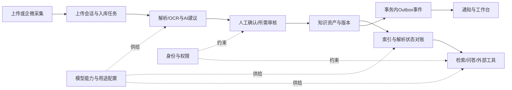

# 全模块地图与修改指南

这份文档回答三个问题：功能属于哪个模块、需求应该从哪里改、改完要检查哪些相邻模块。它是模块梳理的总入口；具体规则继续维护在已有架构、接口和部署文档中。

## 1. 基线与结论

- 梳理日期：2026-11-09。代码基线：主分支 `e6f99fd579d8e278b7084933cd073f05c585d857`。
- 生产依据：操作人回传的 v1.0.1 成功部署报告，应用提交 `36fb851aa3e940cba0e877bf7c3429b6ba4c1d56`。上述主分支相对该提交仅增加部署脚本、脚本测试和企微页面测试等待条件，未增加应用功能。
- 本次完成静态模块映射、关键链路和依赖检查、主工作区差异分类；没有进行全角色浏览器验收，也没有执行生产操作。
- 统计口径：31 个 `*Page.tsx` 文件；34 个 API Python 文件（含 `deps.py`，排除包初始化文件）；159 个 service Python 文件（排除包初始化文件）；12 个 worker task 文件；59 个 ORM 表名定义；OpenAPI 中 227 条路径、252 个 HTTP 操作。文件数不是菜单数或业务模块数，ORM 定义数不是在线数据库检查结果。

**主要问题是业务职责、操作入口和实现位置之间缺少统一索引。** 系统已有分层和边界检查，但复杂度仍集中在上传、知识维护、模型管理及若干大型页面中。后续应以业务链路为单位明确归属，逐段整理；移动文件之前先确认调用关系和状态含义。

现有可复用成果：

- [服务边界](SERVICE_BOUNDARIES.md)：事务、Outbox、工作流与兼容入口的边界。
- [前端结构](FRONTEND_STRUCTURE.md)：页面、controller、领域 API 与传输层分工。
- [接口对照](../api/FRONTEND_API_COVERAGE.md)：252 个操作逐项对应前端或系统集成；其中 203 个找到静态调用。静态覆盖不等于实际业务验收。
- [架构检查](../../scripts/check_architecture.py)：本次通过。其扫描图包括包模块在内共 161 个 service 模块，未发现扫描范围内的导入环；六个历史 API 仍有受数量上限约束的 ORM 操作。

## 2. 产品模块总表

下表是建议采用的维护责任分组，**不是要求新增 14 个菜单或拆成 14 个服务**。当前导航仍按工作台、知识库、项目空间、审批中心、管理中心及账号工具组织。

页面路径以 [App.tsx](../../src/App.tsx) 为准，菜单分组以 [workspaces.ts](../../src/navigation/workspaces.ts) 为准。下表中的 API 文件均位于 `backend/app/api/`。

| 模块 | 用户目的与责任边界 | 页面或入口 | API 文件 |
| --- | --- | --- | --- |
| M01 工作台与通知 | 汇总当前用户的待办、动态与业务通知；任务完成由业务模块判定，通知已读不能替代任务完成 | `/`、工作台任务/通知面板 | `workbench.py`、`notifications.py` |
| M02 身份、人员与权限 | 登录会话、工作身份、公司角色、项目成员、访问规则；系统管理员身份不自动获得业务原文权限 | 登录面板、`/admin/people`、`/admin/permissions`、`/admin/auth-security` | `auth.py`、`people.py`、`permissions.py`、`deps.py`；安全运维接口亦在 `ops.py` |
| M03 项目协作 | 项目概览、成员协作、项目设置、项目资料入口；资料内容及授权规则仍由知识/权限模块维护 | `/projects`、`/project/:id`、`/project/:id/knowledge`、`/project/:id/settings` | `projects.py`，复用知识、审核及问答 API |
| M04 知识库、目录与命名 | 个人/项目/公司库的组织方式、正式目录、库内子目录、命名规则及公司库治理 | 知识库目录区、`/company-governance`、`/admin/company-kb`、`/admin/naming-rules` | `personal_kb.py`、`company_kb.py`、`naming.py`；库内目录操作亦在 `knowledge.py` |
| M05 上传与外部采集 | 接收文件、恢复上传、处理重复资料、建立待确认任务；企微扫描提供外部来源 | `/upload`、`/admin/wecom-scan`、MCP 上传入口 | `ingest.py`、`wecom_scan.py`；MCP 适配在 `agent_operations.py` |
| M06 解析、入库与索引运行 | 抽取/OCR、AI 建议、确认入库、索引、重新解析、恢复与作业跟踪 | 上传过程、`/admin/ingest`、资料解析状态 | `ingest.py`、`ops.py`；部分索引命令在 `knowledge.py` |
| M07 知识阅读、版本与维护 | 列表和详情、元数据、版本、纠错、维护、归档/恢复/删除、受控预览 | `/knowledge`、`/knowledge/:id`、`/my/knowledge`、`/knowledge-maintenance` | `knowledge.py`、`my_knowledge.py`、`lifecycle.py`、`preview.py` |
| M08 审核、资产化与原文授权 | 个人提交项目、资料资产化、升级公司、验证证据，以及原文申请/授权/撤销 | `/review`、`/review/completed`、`/original-access`、`/original-access/grants` | `review.py`、`original_access.py` |
| M09 检索、问答与内容生成 | 召回、排序、权限裁剪、引用和答案；生成不绕过资料访问规则 | 知识检索、项目问答、资料相关生成操作 | `search.py`、`agent.py`；模型选择选项在 `generation_models.py` |
| M10 模型管理 | 供应商连接、模型登记、能力测试、用途接入、默认模型、知识库配置与迁移 | `/admin/weknora-models` | `model_registry.py`、`model_connections.py`、`generation_models.py`、`weknora_admin.py`、`weknora_options.py` |
| M11 外部助手与 MCP | 外部调用身份、授权、范围、工具适配、审计；业务动作复用对应领域服务 | `/my/workbuddy`、`/mcp-authorize`、人员页外部助手区、`/mcp` | `agent_gateway.py`、`agent_operations.py`、`agent_registry_api.py`、`mcp_oauth.py` |
| M12 运维、审计与告警 | 运行健康、队列/索引诊断、调用审计、安全事件和告警；不代替业务审批 | `/admin/ingest` 运行诊断、`/admin/audit`、`/admin/alert-settings`、健康接口 | `ops.py`、`audit.py`、`alert.py`、`health.py` |
| M13 帮助、版本与发布 | 使用教程、更新日志、发布身份、公告草稿及部署记录 | `/help`、`/release-notes`、`/admin/release-notes`；发布脚本 | `release_notes.py`，发布身份亦在 `health.py` |
| M14 应用外壳与通用交互 | 导航、角色入口、登录承载、抽屉、确认框、错误和加载态、手机布局 | `AppLayout`、`App`、`LoginPage`、`NotFoundPage`、通用组件 | 不自建业务 API；复用身份和各领域 API |

边界容易混淆的地方：

- “公司库治理”是治理工作视图，“公司库资料”是资料阅读视图；可共享数据，但动作和角色不同。
- “项目资料”是项目上下文中的知识视图，不能复制出另一套删除、版本或权限规则。
- “知识维护”负责业务内容质量，“入库管理”负责技术处理与恢复；两者的失败含义和可执行动作不同。
- “升级审核”“原文授权”“纠错审核”拥有不同状态和授权效果，入口可归组，状态不能直接合并。
- “模型连接可用”“某能力测试通过”“已接入用途”“被选为默认”“历史知识库已迁移”是不同结论。

## 3. 实现入口与数据归属

以下文件均以仓库根目录为起点；服务名位于 `backend/app/services/`。列的是负责业务行为的主要入口，完整接口清单复用已有接口对照文档。

| 模块 | 后端主要实现 | 主要数据/状态 | 异步或外部依赖 |
| --- | --- | --- | --- |
| M01 | `workbench.py`、`notifications.py`、`notification_targets.py`、`notification_event_consumers.py` | `business_notifications`；任务读取各领域真实状态 | `domain_events.py`、`outbox.py`；worker `outbox.py`、`notifications.py` |
| M02 | `identity.py`、`work_identity.py`、`auth_session.py`、`people.py`、`permission.py`、`permission_rules.py`、`session_revocation.py` | `users`、公司角色、`project_members`、`user_sessions`、`permission_rules` | 企微身份、登录风控；所有业务读写依赖此边界 |
| M03 | `projects.py`、`project_overview.py`、`discoverable_projects.py` | `projects`、项目成员；项目库映射复用 M04/M10 | 企微项目空间、知识库初始化 |
| M04 | `directories.py`、`knowledge_directories.py`、`naming_rules.py`、`personal_kb.py`、`company_kb.py`、`company_governance.py` | `naming_rule_revisions`、`knowledge_directories`；规则版本、草稿并发版本 | WeKnora 知识库映射；影响上传确认、列表、审核发布和外部工具 |
| M05 | `upload_sessions.py` 及 `upload_session_*`、`upload_transport.py`、`upload_duplicates.py`、`wecom_scan.py` | `upload_sessions`、items、transport batches、`wecom_scan_*`、`ingest_tasks` | 存储、企微；worker `wecom.py` |
| M06 | `ingest.py`、`ingest_confirmation.py`、`ingest_status.py`、`jobs/ingest_processing.py`、`content_processing.py`、`indexing.py`、`index_recovery.py`、`indexing_ops.py` | 入库任务、AI 结果/派生文件、`indexing_operation_jobs`、解析与索引状态 | worker `ingest.py`、`ingest_recovery.py`、`parse.py`、`indexing.py`；OCR、Office、WeKnora |
| M07 | `knowledge.py` → catalog/projection/index commands；`knowledge_metadata.py`、`knowledge_versions.py`、`knowledge_review.py`、`lifecycle.py`、`preview.py` | `knowledge_assets`、versions/chunks/file objects/summaries/tags、`knowledge_corrections`、生命周期事件 | 存储、ONLYOFFICE、索引；worker `lifecycle.py` |
| M08 | `review.py` → read/evidence/company/decision workflow；`review_transitions.py`、`original_access.py` | `review_tasks`、验证证据、个人提交、`original_access_requests`、`access_grants` | `workflows/project_ingest_approval.py`；worker `upgrade.py`、`original_access.py`；Outbox |
| M09 | `search.py`、`search_queries.py`、`retrieval.py`、`retrieval_lexical.py`、`search_rerank.py`、`agent.py`、`knowledge_qa.py` | 调用/引用/权限判定记录、LLM 用量；读取知识与授权状态 | WeKnora、外部 LLM、权限网关、摘要策略和脱敏 |
| M10 | `model_registry.py`、`model_provider_catalog.py`、`model_probe.py`、`model_connections.py`、`generation_models.py`、`weknora_models.py`、`weknora_defaults.py`、`kb_migration.py` | `provider_connections`、`registered_models`、`content_generation_models/settings`、`weknora_default_models`、KB mappings；WeKnora 另存实际模型 | 厂商 API、WeKnora；迁移交给索引作业链路 |
| M11 | `external_agent_gateway.py`、`agent_workbench.py`、`mcp_operation_tools.py`、`workbuddy_remote_mcp.py`、`mcp_auth.py`、`mcp_oauth.py` | 工具授权、外部助手白名单、调用/决策记录；业务实体仍由所属模块管理 | `integrations/workbuddy-mcp/`；当前主入口与 legacy Agent 适配共存 |
| M12 | `audit.py`、`alert.py`、`auth_security_ops.py`、`indexing_health.py`、`jobs/ops_alerts.py` | `audit_events`、登录尝试、告警规则、`notification_records`、运行快照和心跳 | worker `ops_health.py`、`ops_alerts.py`；host Nginx、容器与备份工具 |
| M13 | `release_notes.py`、`release_deployment.py`；`src/content/helpGuides.ts` | `release_notes`、`release_note_reads`、镜像内发布身份 | `scripts/deploy_release.py`、部署/回退脚本、CI |
| M14 | `src/App.tsx`、`src/layouts/`、`src/navigation/`、`src/auth/`、`src/components/`、`src/api/http.ts` | 路由、界面状态、能力位；不拥有业务实体状态 | 所有页面共用；通用改动影响桌面和手机 |

平台级共享规则：

1. KAP 负责业务资产、角色、审批、授权和审计；WeKnora 负责其知识库、解析/向量检索及模型执行。跨系统状态通过映射与对账连接。
2. `storage.py` 管原始文件存取，`canonical_markdown.py` 管规范正文，`extraction.py`/OCR/Office 处理不同来源；改解析器不能绕开文件权限和资源限制。
3. `permission.py`、摘要策略和脱敏规则应用于列表、检索、问答、预览及外部助手。前端能力位仅控制入口体验。
4. 业务状态变化与 Outbox 事件应在同一事务提交。通知消费者投影通知，不能反向决定审批、入库或授权状态。
5. FastAPI 请求会话与 Celery worker 会话分开；任务包装、业务工作流、状态恢复各有责任，不能把一次 HTTP 返回当作异步工作完成。

## 4. 五条必须连起来看的业务链路

| 链路 | 从哪里跟踪 | 一次修改必须确认的含义 |
| --- | --- | --- |
| 上传 → 解析 → 确认 → 可检索 | `useUploadFlow` / `useUploadIntake` → `ingest` API → upload/ingest services → worker → WeKnora → 状态对账 | 字节已上传、解析完成、确认入库、索引可用四者不能用一个“成功”替代；失败、取消、重试要有各自终态 |
| 目录 → 命名 → 发布资料 | 目录治理 → `naming_rules` / `directories` → 上传确认和审核发布 → 资料列表与外部工具 | 正式规则版本与库内目录同时有效；修改父目录不能留下孤立子目录；并发草稿不能相互覆盖 |
| 资料 → 审核/资产化 → 通知 | 资料详情/项目资料 → review workflow → 知识状态与事件 → Outbox → 通知/工作台 | 审核结论、资产状态、索引、待办与通知属于不同投影；审核通过后各入口应重新取权威状态 |
| 检索/原文申请 → 授权 → 预览/问答 | search/retrieval 或 original_access → `permission` → preview/agent/gateway | 看得到摘要不等于可读原文；授权过期/撤销必须影响预览、问答和外部工具 |
| 供应商连接 → 测试 → 接入用途 → 默认/迁移 | ModelOnboarding → registry → provider probe → generation/WeKnora 适配 → defaults/KB migration | 连接凭据版本、模型版本、测试签名、用途绑定分别判断；换默认不能被表述为历史知识库已迁移 |

数据字典先以 [enums.py](../../backend/app/schemas/enums.py) 和对应 schema/model 为准。个人/项目/公司是归属范围，资料区/资产区是同库内状态；保密级别、资产生命周期、版本状态、解析/索引状态、审核状态与授权状态是独立维度。

## 5. 已确认的复杂度与待决策事项

下面区分代码事实与建议。文件行数和静态导入数量用于定位复查入口，不直接代表缺陷，也不作为机械拆文件的目标。

| 事项 | 证据 | 修改困难的原因 | 建议 |
| --- | --- | --- | --- |
| 多套模型配置路径共存 | `AdminWeKnoraModelsPage` 同时组合 ModelOnboarding、UnifiedModelConnectionsSection、WeknoraModelsSection；API 有 registry/connections/generation/WeKnora 四条路径 | 新登记模型、旧业务模型、旧底座模型及其默认用途不是同一套实体；只改一个弹窗或一种测试，其他路径仍可能不同 | 做“连接—模型—能力—用途—默认/迁移”对照表，明确新旧入口的责任和退出条件；迁移另立任务 |
| 模型能力覆盖不一致 | registry catalog 当前声明 chat/embedding/rerank；已保存 VLLM 的图片测试走 `WeKnoraClient.check_vision_model` | 新接入能力、已保存模型测试能力、实际业务用途支持范围不相同 | 页面明确显示能力范围；新增能力时同时覆盖登记、验证、接入及用途消费，不能只加下拉选项 |
| 上传复杂度跨多层集中 | `ingest.py` 1492 行；`useUploadIntake.ts` 1358 行；`usePendingBatchReviewController.ts` 1110 行；`useIngestConfirmation.ts` 1004 行 | 页面拆出 hook 后，单个 hook 仍承担多阶段流程；状态、恢复和业务动作需要一起追踪 | 先列状态转换表和写入责任，再按传输/解析/确认/恢复拆用例；保留现有幂等、租约与取消保护 |
| 知识多视图重复承载操作 | ProjectKnowledgePage 1187 行、KnowledgeListPage 1089 行、MyKnowledgePage 997 行；资料、维护、项目页面共享实体 | 同一操作出现在不同上下文，容易只更新一处权限、结果反馈或刷新逻辑 | 统一领域命令和结果协议，复用纯交互部件；保留各场景的可见性和上下文差异 |
| API 层仍有历史事务边界 | 架构检查对 auth/generation_models/knowledge/model_connections/ops/weknora_admin 保留受限 ORM 操作基线 | 修改入口有时在 API，有时在 service，事务责任不能从目录名直接判断 | 新逻辑优先放所属应用服务；逐个迁出历史操作，缩减基线，而非放宽检查 |
| 公共服务影响面较大 | service 静态导入：audit 被 61 个模块引用，storage 26、permission 25、weknora_client 21、llm_client 18 | 这些公共能力天然被广泛使用，改其契约容易跨业务传播 | 为变更列出调用方和契约测试；不因为被引用多就继续拆成更多通用层 |
| 角色说明与实际判断有偏差 | `model_connections._require_operator` 和 `weknora_admin._require_operator` 允许 admin 或治理角色，但拒绝提示仅写总经理/总监；部分概述仍描述旧权限口径 | 文案、导航权限、接口读写条件容易被当成同一规则 | 单列“可看页面/可读配置/可写全局/可改本项目/可读业务原文”矩阵，以后端判断和测试为准 |
| 发布方式有通用入口和定点脚本 | `deploy_release.py` 与 prepare/cutover/rollout、WeKnora rehearsal 系列并存；本次 vision helper 固定准备目录和镜像 | 历史修复脚本容易被误当通用下一次发布入口 | 发布索引区分通用发布、仅诊断、隔离验收、一次性迁移、定点补丁；保留历史记录，不直接复用旧切换命令 |
| 开发目录与主分支存在版本混合 | 主工作区 HEAD `3e3fce6`，审计基线为 `e6f99fd`，部分未跟踪文件已存在于主分支 | “本地改过”“已合并”“线上版本”容易混为一谈 | 先核对差异来源，后续工作从最新主分支的独立分支开展；既有本地改动逐项保留和比对 |

## 6. 从需求找到修改入口

| 你想改什么 | 首先定位 | 必须连带检查 | 针对性验收 |
| --- | --- | --- | --- |
| 调整导航、页面名称或角色入口 | `src/navigation/workspaces.ts`、`src/App.tsx`、`src/auth/permissions.ts` | 直接访问路由、工作身份切换、手机导航、后端权限 | 外壳/权限组件测试；角色可见与无权直达；不把改文案当作改权限 |
| 调整模型配置与测试 | M10 页面、`src/api/modelRegistry.ts` / modelConnections / weknoraModels、对应 service | 新登记和旧模型、能力、用途默认、知识库配置、凭据版本失效 | 供应商协议单测 + 隔离真实能力测试 + 编辑/测试/默认状态 UI；图片成功不外推音视频 |
| 调整目录或命名 | AdminNamingRulesPage → naming API → naming_rules/directories | 库内子目录、草稿并发、上传确认、审核发布、列表筛选、MCP | 目录/命名测试及 `directory-governance.ui-qa.mjs`；旧资料路径与新增资料都检查 |
| 新增文件格式、改上传或重试 | UploadPage → `src/pages/upload/` → upload/ingest services → worker | 重复文件、取消、租约、重型解析队列、内存/超时、恢复及后续索引 | 对应上传/解析用例 + `upload-ingest.ui-qa.mjs`；失败恢复和不会重复入库 |
| 改删除、归档、版本或纠错 | knowledge index commands / versions / review / lifecycle | 所有知识列表、历史版本、索引、预览、原文授权、外部助手、通知 | 知识详情/信任/版本测试，检查“不可见”与“不可访问”的一致性 |
| 改资产化、升级或原文审批 | review workflow / original_access | 审核人角色、证据、并发处理、资产状态、授权有效期、工作台通知 | review/original-access 测试及 `review-access.ui-qa.mjs`；接受、拒绝、重复提交、撤销 |
| 改检索、引用或回答 | search/retrieval/agent/knowledge_qa | 目录范围、可见性、摘要和原文边界、模型默认、外部工具 | 权限裁剪与检索测试；真实召回/引用用例；拒绝把仅有输出当作成功 |
| 改外部助手能力 | agent_operations / mcp_operation_tools / remote_mcp | 调用人身份、工具声明、对应业务服务、幂等、审计、安全响应 | MCP 集成和授权测试；Web 与工具执行同一业务规则 |
| 改任务、消息或告警展示 | workbench/notifications/operationStatus；Outbox 消费者 | 来源任务的真实终态、重复事件、通知已读、刷新和深链接 | workbench/notifications/outbox 测试；成功、失败、重试和无权限目标 |
| 改部署与版本展示 | release manifest / release_deployment / deployment scripts | 迁移必要性、前后端版本一致、worker 兼容、回退粒度、镜像身份 | 对应部署脚本测试、隔离演练与正式入口版本检查；应用回退不自动回滚已接收业务写入 |

对每项改动，在 PR 中至少写清：**所属模块、具体用户场景、权威状态/数据、会受影响的入口、是否需要迁移、验收结果**。纯样式调整可简化；涉及状态、权限和异步处理时必须明确失败与恢复行为。

## 7. 主工作区差异单列

工作区：`D:/projects/knowledge-asset-platform`，分支 `codex/frontend-template-permissions`，HEAD `3e3fce619ae8ad50a8c41b357f640d7e74f9297c`。本轮只读取，不暂存、删除、重置、合并其中的改动。

对该工作区 status 中业务代码、测试、文档、脚本及发布说明展开目录后比较；文本比较归一化 CRLF/LF。以下是这一批候选文件的结果，不是整个仓库的差异总数：18 个与主分支内容相同、58 个同路径内容不同、35 个主分支有而本地已删除、31 个仅本地该路径存在，另有 3 个旧路径双方均不存在。路径重命名须继续配对，不能按文件数推断功能增减。

| 差异类别 | 已核对的例子 | 后续处理 |
| --- | --- | --- |
| 本地显示未提交，但内容已在主分支 | `0076_knowledge_review_loop.py`、knowledge_correction model、knowledge_review schema、permission、domain_events、部分测试与 release notes | 标为已吸收候选，不能再次作为新功能批量提交；保持原工作区原状，整理时再逐项处理 |
| 功能已在主分支，但本地版本不同 | knowledge_review service、KnowledgeTrustPanel、KnowledgeMaintenancePage、目录治理及命名相关代码 | 必须比较语义，不视为整块“待上线”；本地主路径例如缺少主分支的命名草稿 `expected_draft_updated_at` 和库内子目录合并逻辑，直接覆盖会丢失保护 |
| 文档和测试文件改名/整理 | docs 下小写连字符目录、若干 migration 测试改为描述性文件名、docs/README | 作为独立文档/测试整理批次，核对链接和测试发现，避免与业务功能一起合并 |
| 页面、路由、样式和验收脚本的历史差异 | App/AppLayout、知识列表/个人库/项目资料、入库管理、帮助页及 UI QA | 以当前主分支为底重新确认哪些设计仍需要；本地路由缺少主分支后来加入的入口，不能整文件覆盖 |

这份对比只能说明文件差异，不能证明所有未提交修改的意图、来源、完成度或是否仍需保留。真正进入合并前要按改动主题做三方对比和单独验收。

## 8. 分阶段整理路线

| 阶段 | 要完成的事 | 完成标准 |
| --- | --- | --- |
| A. 建立统一基线与地图（本轮静态初稿） | 明确主分支/生产/本地差异；14 个模块、主要入口、数据与链路建立对应关系 | 有可定位源码的总入口；能按需求找到负责模块；静态结论与运行验证分开 |
| B. 逐模块确认产品职责 | 逐项确定主要用户、核心任务、页面职责、状态含义、入口是否重复、操作结果在哪里出现 | 每个模块都有明确保留/合并/拆分/废弃建议；跨模块规则有唯一权威位置；不以文件搬迁代替业务判断 |
| C. 用模型管理做一条完整试点 | 统一模型对象和能力/用途术语；列新旧路径兼容策略；把状态、错误和权限说明对齐 | 一个需求能从页面跟到接口/服务/外部适配及测试；旧模型和新登记模型的有效配置均可解释和验收 |
| D. 整理知识与治理主线 | 统一知识多视图的动作契约，核对目录/命名、版本/维护、审核/原文授权的责任 | 同一业务动作在不同入口权限、结果和刷新一致；知识状态变化可以追踪到索引与通知 |
| E. 分解上传与处理链路 | 对上传、解析、AI 建议、确认、索引、重试恢复分别定义状态所有者，再逐个收窄大型 service/hook | 单模块修改无需重新追完整上传实现；失败、取消、重试、并发和恢复均有针对性验证 |
| F. 收口平台与发布约定 | 补齐角色动作矩阵、通用错误/作业状态、公共适配器契约、脚本用途与发布入口索引 | 新改动沿既有责任入口进入；架构检查可以阻止已治理的边界重新扩大 |

每一批只处理一个可验收的业务主题，将行为变化和纯代码搬迁分开提交。涉及真实外部服务先在隔离环境验收；生产发布沿已验证的发布/回退流程进行。这里的阶段是依赖顺序，不是已经获验收的重构结果或承诺工期。

下一轮模块评审建议从“工作台—知识库—项目空间—审批—管理中心”的用户任务走一遍，再用本地图定位实现。每个模块统一回答：**为谁服务、解决什么任务、拥有哪些数据和状态、依赖谁、谁依赖它、改动如何验收**。
